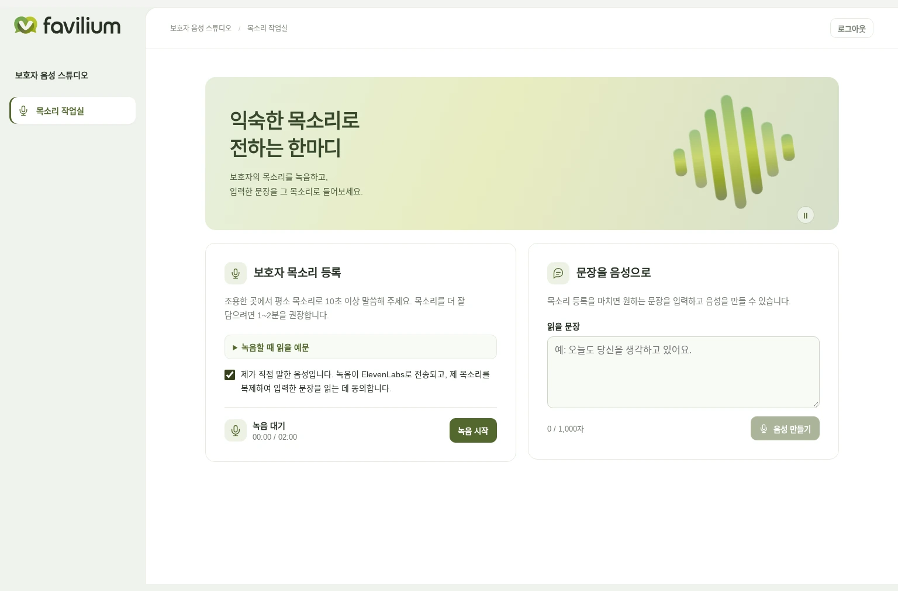

# Favilium · 보호자 목소리

보호자가 본인 목소리를 한 번 녹음하면 연구자가 입력한 한국어 문장을 그 목소리로 합성하고 MP3로 재생하거나 저장할 수 있습니다. 보호자 설문, 환자 관리, 환자 음성 수집 및 자유 대화는 이 버전에 포함되지 않습니다. YAICON에서 개발한 전체 서비스와 원래 연구 코드는 [main](https://github.com/GracieRho/KoF5-TTS-delirium/tree/main)에 있습니다. 이 서비스의 코드는 `clinical/voice-only` 브랜치에서 관리합니다.



## 처음 실행하기

Python 3.11 이상, uv, Node.js 24 및 npm을 사용합니다. 저장소 루트에서 실행합니다.

```bash
git clone --branch clinical/voice-only --single-branch https://github.com/GracieRho/KoF5-TTS-delirium.git
cd KoF5-TTS-delirium
cp .env.example .env
```

`.env`에 `ELEVENLABS_API_KEY`, 로컬 DB 경로 `FAVILIUM_DB_PATH`를 설정합니다. 브라우저별 작업실 쿠키의 서명 키 `FAVILIUM_SESSION_SECRET`은 32자 이상의 무작위 값으로 설정합니다. 이 값을 유지하면 ElevenLabs API 키를 교체해도 같은 브라우저에서 기존 목소리를 이어 쓸 수 있습니다. ElevenLabs 키에는 음성 등록·조회·삭제와 텍스트 음성 합성에 필요한 권한이 있어야 합니다. 계정에서 Instant Voice Cloning을 사용할 수 있어야 합니다. 기능별 권한 이름은 ElevenLabs의 API Keys 화면에서 확인할 수 있습니다.

```bash
uv sync --locked
npm --prefix apps/portal_web ci
npm --prefix apps/portal_web run build
uv run --env-file .env python scripts/run_backend.py
```

같은 기기에서 [http://127.0.0.1:8765/studio](http://127.0.0.1:8765/studio)를 엽니다. iPad 등 다른 기기에서는 마이크를 사용할 수 있도록 HTTPS 주소로 접속합니다.

## 사용 방법

1. 서비스 주소(`/` 또는 `/studio`)를 열면 목소리 녹음실이 바로 표시됩니다. 녹음 전에 보호자 본인의 동의와 외부 전송 범위를 확인합니다. 참여자 등록번호나 환자 계정은 입력하지 않습니다.
2. 모든 보호자는 조용한 곳에서 화면에 제시된 동일한 네 문장을 순서대로 한 번씩 읽어 녹음합니다. 가족에게 이야기하듯 평소 속도로 한 문장씩 또렷하게 읽습니다. 등록 가능한 녹음 길이는 10~120초입니다. 녹음을 들어 보고 필요하면 다시 녹음한 후 등록합니다.
3. 목소리가 준비되면 연구자가 검토한 문장을 입력해 합성합니다. 예를 들어 “창가에 햇살이 비치네요. 오늘도 곁에서 응원하고 있어요.”를 입력합니다. 음성은 재생 버튼을 눌러 듣고 필요하면 MP3를 내려받습니다. 시간·장소 등 지남력 정보는 매번 연구자가 사실을 확인해 입력합니다.
4. 같은 브라우저에서 여러 문장을 생성할 수 있습니다. 연구 보관에 별도 동의한 경우 공용 기기에서 ‘다음 보호자 녹음’으로 전환할 수 있습니다. 사용을 종료해 자료를 지울 때는 ‘등록한 목소리 삭제’를 선택합니다.

## Vercel에서 별도의 연구용 주소로 운영하기

기존 Favilium 운영 프로젝트와 분리할 때는 Vercel 프로젝트를 하나 더 만들고 이 저장소를 연결합니다. Root Directory는 저장소 루트, Production Branch는 `clinical/voice-only`로 지정합니다. 기존 Favilium 도메인은 원래 프로젝트에 둡니다. 브랜치 미리보기를 쓸 때는 아래 변수를 해당 브랜치의 Preview 환경에만 지정합니다. 연구팀용 미리보기의 접근 범위는 Vercel의 Deployment Protection에서 관리합니다. 이 보호가 켜져 있으면 Vercel이 먼저 팀 계정 로그인을 요청할 수 있습니다.

1. 연구 전용 Supabase 프로젝트에서 [clinical/voice_sessions.sql](clinical/voice_sessions.sql)과 [clinical/research_archive.sql](clinical/research_archive.sql)을 순서대로 실행합니다. 음성 데이터는 연구 보관에 동의한 경우에만 등록 참조 번호와 연결됩니다.
2. Vercel 서버 환경에 `FAVILIUM_SUPABASE_URL`, `FAVILIUM_SUPABASE_SERVICE_KEY`, `ELEVENLABS_API_KEY`, `FAVILIUM_SESSION_SECRET`을 설정한 뒤 배포합니다. Supabase 서버 비밀 키와 ElevenLabs 키에 `VITE_` 접두사를 붙이면 안 됩니다. Vercel에는 SQLite 경로를 설정하지 않습니다.
3. 배포된 HTTPS 주소의 `/studio`에서 연구자 본인 목소리로 등록, 한국어 합성, 재생과 삭제까지 확인합니다. iPad Safari에서도 마이크 권한·재생을 직접 확인합니다.

## 연구자 음성 보관함

- 연구팀이 공유한 링크를 열면 파란색 연구 보관함이 바로 표시됩니다. 열람 링크로 목록 검색, WAV·MP3 재생 및 다운로드를 할 수 있습니다. 관리 링크로는 추가로 새 문장을 합성하고 목소리와 보관 자료를 삭제할 수 있습니다. 보호자 녹음실은 `/studio`에 있습니다.
- 전용 링크는 `/research#access=…` 형식입니다. 두 링크는 각각 소지자에게 해당 권한을 주므로 실제 자료에 접근하도록 지정한 연구팀 안에서 공유합니다. 일반 주소 `/research`에서는 예시 화면을 볼 수 있습니다. 공용 기기에서 마치면 ‘보관함 나가기’를 누릅니다.
- 운영자는 `secrets.token_urlsafe(32)`로 두 링크의 난수를 개별 생성하고, 각 난수의 SHA-256 16진 해시를 `FAVILIUM_RESEARCH_VIEW_HASH`와 `FAVILIUM_RESEARCH_MANAGE_HASH`에 설정합니다. 서버 설정은 임상 브랜치 Preview에만 적용합니다. 새 해시로 교체해 다시 배포하면 해당 링크와 해당 주소에서 쓰던 세션이 만료됩니다. 브라우저는 링크를 열 때 1시간 동안 쓸 수 있는 쿠키를 받고, 열린 화면에서 자동 갱신합니다.
- 예전에 등록한 목소리에는 등록 상태만 표시됩니다. 해당 보호자가 기존 녹음실에서 ‘연구 보관 시작’에 동의하면 이후 생성하는 문장과 MP3를 보관합니다. 이전의 원본과 MP3는 자동으로 복구되지 않습니다.

## 데이터와 운영

- 별도 연구 보관 동의는 기본 해제입니다. 등록 시 선택하면 원본 WAV와 이후에 생성한 문장·MP3를 연구용 Supabase에 보관합니다. 선택하지 않으면 등록 상태·작업 식별자만 보관합니다. 파일·문장은 승인된 연구자 API에서 읽습니다. 목소리 등록 시 WAV가, 음성 생성 시 입력한 문장이 ElevenLabs로 전송됩니다. 공급자의 보관 정책 및 생성 이력은 계정 설정과 계약에 따릅니다. 내려받은 MP3는 기기나 연구자가 지정한 저장 위치에 남습니다.
- 한 브라우저 프로필은 한 번에 하나의 보호자 목소리를 관리합니다. 같은 브라우저 프로필에서 같은 주소를 다시 열면 기존 목소리를 이어 쓸 수 있습니다. 쿠키 삭제·만료·다른 기기 사용 시 연결을 잃을 수 있으므로 연구를 마칠 때는 쿠키 삭제 전에 목소리 삭제를 확인합니다. 연결을 잃은 경우 연구자가 보관함에서 참조 번호로 찾아 삭제할 수 있습니다.
- 불확실한 등록·삭제 요청은 결과를 확인한 후 진행합니다. 삭제 중에는 합성을 허용하지 않습니다. 연구 전용 계정에서 사용량 한도를 설정할 수 있습니다.
- 실제 환자에게 재생하기 전에는 연구진이 승인된 연구계획과 동의 범위, 외부 전송·보관·삭제 절차, AI 합성 음성 고지와 재생 중단 절차를 확인합니다. 보호자 체크박스는 연구 참여 서면동의를 대신하지 않습니다.

## 검증 및 개발

```bash
uv run python -m unittest discover -s tests
npm --prefix apps/portal_web run check
python3 scripts/generate_architecture.py --check
python3 -m unittest scripts/test_generate_architecture.py
git diff --check
```

제공자 문서 · [녹음 길이와 품질](https://elevenlabs.io/docs/help-center/product/voices/voice-cloning/what-files-do-you-accept-for-voice-cloning) · [목소리 등록](https://elevenlabs.io/docs/api-reference/voices/ivc/create) · [음성 합성](https://elevenlabs.io/docs/api-reference/text-to-speech/convert) · [목소리 삭제](https://elevenlabs.io/docs/api-reference/voices/delete)
